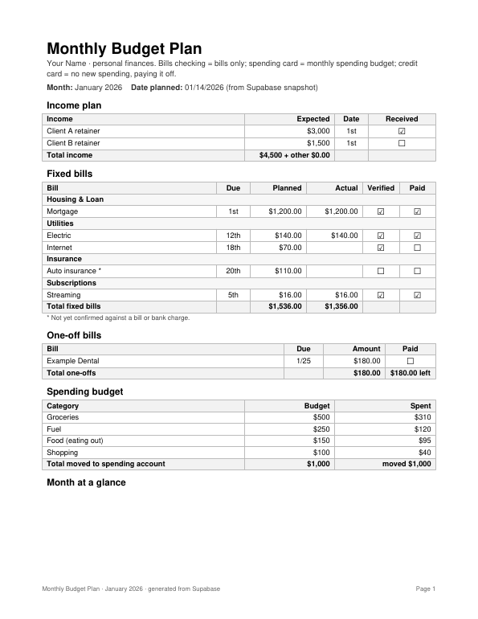
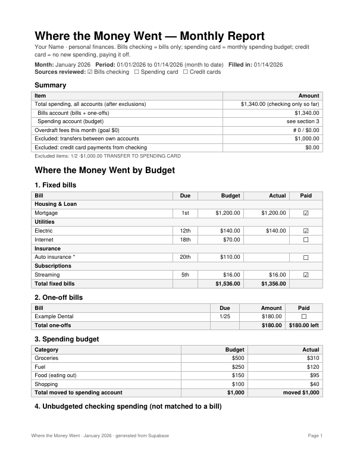

# GrokBudgetTracker

A personal **budget + debt-snowball tracker** that runs inside **Grok Bot**, with a free **Supabase** Postgres database as the ledger. It is a template: fork it, apply the migrations to your own Supabase project, register your bank accounts, and let a Grok Bot "Finance" bot keep the books by chat.

> Sample data in this repo is fake. Never commit your own ledger rows, account numbers, balances or keys.

## Features
- **Account registry (required)** - every tracked checking, savings, credit-card, Venmo, PayPal or cash account is a row in `accounts` with nickname, institution, type, last 4, owner, Plaid connection status and a funding role (bills / spending / debt ...).
- **Fixed bills** - `bill_templates` define recurring bills; each month gets `bill_instances` (unpaid -> paid -> cleared).
- **One-off bills** - irregular bills (`one_off_bills`), with carry-over to the next month.
- **Bill photos and receipts** - send a photo; Grok reads it, confirms, stores the file in your private Supabase Storage bucket and links it (`documents`).
- **Spending buckets** - monthly budgets (`spending_budgets` + `budget_months`) such as Groceries, Fuel, Dining out, Shopping. Ask "show me my buckets" or "show me my groceries bucket" and Grok replies with a bucket chart ([examples](docs/images/buckets/)).
- **Expense types** - every transaction is labeled `recurring_fixed`, `one_off`, `budget_bucket`, `transfer` or `income`, and linked to the bill, one-off or bucket it belongs to.
- **Categories template** - a default category list (`supabase/seed_categories.sql`) you can edit.
- **Income** - expected sources and actual deposits (`income_sources`, `income_events`); refunds are tracked but not counted as income.
- **Transfers** - planned and actual moves between your own accounts (for example funding the spending card).
- **Debt snowball** - `debts` + `debt_payments`; the report generator simulates snowball and avalanche payoff dates.
- **Any transaction source** - one `transactions` table for Plaid bank/card feeds, Venmo, PayPal, CSV imports and manual entry (`source` + `external_id`).
- **Split payments** - `transaction_allocations` splits one transaction across bills, one-offs, budget buckets and debts.
- **Daily Transaction Review** - every morning the bot pulls new transactions, auto-matches obvious recurring bills, then interviews you one transaction at a time and recaps bucket balances.
- **Daily bank sync and matching** - the bot pulls new transactions from the Finance (Plaid-based) connector, matches them to bills, and asks you about the rest one at a time.
- **Monthly dashboard and PDFs** - `templates/build_reports.py` renders an HTML dashboard, a *Monthly Budget Plan* PDF and a *Where the Money Went* PDF from one JSON snapshot. `templates/build_blank.py` prints blank fill-in-by-pencil versions.

## What you get
**Interactive dashboard Page (default).** A Grok Bot Page refreshed each month: headline metrics, bills with status, bucket bars, income expected vs received, the needs-review queue per account, and the debt snowball, with switchable views. See [docs/images/dashboard-page.md](docs/images/dashboard-page.md) and [templates/DASHBOARD.md](templates/DASHBOARD.md).

**Printable PDFs (optional).** Rendered from the same month's data (fake sample shown):

| Monthly Budget Plan | Where the Money Went |
|---|---|
|  |  |

Blank fill-in versions: [plan](docs/images/monthly-budget-plan-blank.png), [where the money went](docs/images/where-the-money-went-blank.png).

## How it works inside Grok Bot
```
Finance connector (Plaid) --daily--> Finance bot --SQL via Supabase connector--> Supabase (this schema)
                                          |                                          |
                         asks you one item at a time                 dashboard_snapshot(month) JSON
                                                                                     |
                                                            templates/build_reports.py -> HTML + PDFs
```
- One **Finance bot** owns the ledger. Other bots send it facts ("log this as a one-off") instead of writing to the database themselves.
- The database has **row-level security on with no policies**, and `anon`/`authenticated` have no grants, so nothing is reachable through the public API. The bot reaches it server-side through the Supabase connector. **No keys go in this repo or in any file.**

## Setup
Full walkthrough: [ONBOARDING.md](ONBOARDING.md). Short version:
1. **Create a free Supabase account** at [supabase.com/dashboard/sign-up](https://supabase.com/dashboard/sign-up) and **create one project** (free plan: 500 MB, no automatic backups, pauses after about a week idle; check current pricing for Pro).
2. **Connect the Supabase connector** in Grok Bot and confirm the bot can list your project.
3. **Apply the migrations in order** (`supabase/migrations/0001` -> `0008`). Have the bot explain each one and wait for your OK before running it.
4. **Load the category template**: `supabase/seed_categories.sql` (edit first if you want).
5. **Register your bank accounts** (required): one `accounts` row per account; then connect each one through the Finance connector and record its Plaid ids. See ONBOARDING step 5.
6. **Seed settings**: `settings` rows `snowball` (`{"extra_per_month": 0}`) and `balances` (`{"<account id>": {"available": 0}}`).
7. Add your **income sources, bill templates, spending buckets and debts** by chat.
8. Optional: try everything with fake data first (`supabase/seed_example.sql` on a scratch project).
9. Copy `templates/config.example.json` to `templates/config.json` and set your labels and account ids.

## Daily-use prompts
See [prompts/daily-use.md](prompts/daily-use.md). Examples:
- "Sync my checking and match anything to bills."
- "What's left to pay this month?"
- "Log a one-off: dentist $180 due the 25th."
- "Set up a Shopping bucket, $100 a month, from my spending card."
- "Build this month's dashboard and PDFs."
- "When is the snowball done if I add $100 a month?"

## Updates
The installed version is in `VERSION`. At setup the bot records it and adds a monthly **GrokBudgetTracker update check** routine: when a new version is out it tells you what's new in plain words and asks before applying anything (migrations one at a time, only after your OK; your data is never touched). Quiet when there's nothing new. See [docs/updates.md](docs/updates.md).

## Portability
Everything is in **your own Supabase project**: every table (accounts, transactions, bills, buckets, income, debts, categories, settings) and every file (bill photos, receipts, statements in the private `bill-documents` Storage bucket, indexed by the `documents` table). Grok holds no copy of its own. To leave Grok, or move to another tool, any time:
- **Data**: `pg_dump` your project (Supabase dashboard > Database > connection string), or use the dashboard's backup/export.
- **Files**: download the `bill-documents` bucket (Supabase dashboard Storage, or the Supabase CLI / storage API). The `documents.storage_path` column tells you which file belongs to which bill or transaction.
The schema is plain Postgres and documented in [docs/database.md](docs/database.md).

## Repo map
| Path | What |
|---|---|
| `ONBOARDING.md` | Step-by-step setup, including connecting each bank |
| `docs/database.md` | Every table, view and function, with an ER diagram |
| `docs/workflows.md` | Daily sync, matching, categorizing, month rollover, reports, bot roles |
| `supabase/migrations/` | Numbered SQL migrations (schema only, no data) |
| `supabase/seed_categories.sql` | Default category list (no amounts) |
| `supabase/seed_example.sql` | Fake sample data |
| `supabase/functions/bill-documents` | Optional Edge Function to upload documents and make signed URLs |
| `templates/` | Report generators, config, sample snapshot and rendered sample output |
| `prompts/` | Finance bot setup prompt and daily-use prompts |
| `docs/routines.md` | Daily Transaction Review and other routine prompts |
| `docs/updates.md` | How the bot checks for and applies updates |
| `VERSION` | Current release (semver) |
| `CHANGELOG.md` | History |

No license has been chosen yet.
