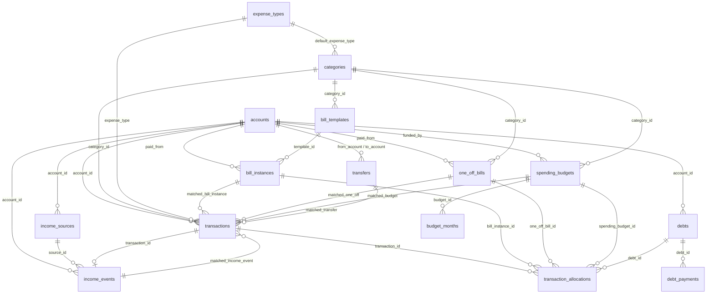

# Database map

Postgres on Supabase, schema `public`. Built by `supabase/migrations/0001`-`0007` in order.
Money: bills, budgets, debts and allocations are positive; in `transactions`, **negative = money out, positive = money in**.
Months are stored as the first day of the month (`2026-01-01`).

## Security
- RLS is enabled on every table with **no policies** (deny-all), and all grants are revoked from `anon` and `authenticated`. Nothing is reachable through the public REST/GraphQL API or the anon key.
- Views use `security_invoker = true`; `dashboard_snapshot()` is `security invoker` with `search_path = ''` and is not executable by `anon`/`authenticated`.
- The bot works server-side through the Supabase connector (SQL). No API keys are stored anywhere.

## ER diagram

## Tables

### accounts (0001, extended 0003) - required registry
Every account the tracker knows about. Sync and categorizing are blocked until at least one active row exists (`registered_accounts` view).
| Column | Type | Meaning |
|---|---|---|
| id | text PK | Short stable id you choose, e.g. `chk-bills` |
| name | text | Original display name (kept for compatibility) |
| nickname | text not null | What the bot calls it |
| institution | text not null | Bank / provider name |
| account_type | text not null | `checking`, `savings`, `credit_card`, `venmo`, `paypal`, `cash`, `loan`, `other` |
| last4 | text | Last 4 digits (exactly 4 digits or null) |
| mask, kind | text | Legacy equivalents of last4 / account_type (0001); new code uses the 0003 columns |
| owner_name | text | Account holder |
| plaid_item_id | text | Plaid connection (item) id from the Finance connector |
| plaid_account_id | text unique | Plaid account id |
| connected | boolean | true once linked; requires both Plaid ids |
| connected_at, last_synced_at | timestamptz | When linked / last successful sync |
| status | text | `active`, `needs_reauth`, `disconnected`, `closed` |
| active | boolean | Still tracked |
| funding_role | text | `bills`, `spending`, `savings`, `debt`, `income`, `none` |
| notes, created_at | | |

### income_sources (0001, extended 0007)
Expected income: `id`, `name`, `expected_amount` (per payment), `frequency` (`weekly`, `biweekly`, `semimonthly`, `monthly`, `irregular`), `next_expected_date` (anchor for weekly/biweekly), `due_day` (day of month for monthly), `account_id` -> accounts (where it lands), `active`, `notes`.

### income_events (0001, extended 0007) - the income table
Actual money received: `id` text PK, `transaction_id` -> transactions (the matching deposit; unique), `source_id` -> income_sources (null for one-offs), `month`, `received_date`, `amount`, `account_id`, `plaid_id`, `kind` (`income`, `one_off_income`, `transfer_in`, `refund`), `inferred` (bot guessed the source), `notes`. Refunds are tracked but not counted as income.

### bill_templates (0001, +category_id 0004)
Recurring bill definitions: `id`, `name`, `default_amount`, `due_day` or `week` (1-5 when only the week is known), `category` (label), `category_id` -> categories, `payee_hint` (text the bank description starts with, used for matching), `unverified` (not yet confirmed against a real bill), `active`.

### bill_instances (0001)
One row per bill per month (`unique (template_id, month)`): `id`, `template_id`, `month`, `due_date`, `amount` (planned), `estimated`, `status` (`unpaid` -> `paid` when you pay it -> `cleared` when the bank shows it), `paid_amount`, `paid_date`, `paid_from` -> accounts, `cleared_plaid_id`, `notes`.

### one_off_bills (0001, +category_id 0004)
Irregular bills: `id` text PK (e.g. `dentist-2026-01`), `payee`, `amount`, `month`, `received_date`, `due_date`, `receipt_path` (photo of the bill), `carried_over_from` (month it rolled from), `status`, `paid_date`, `paid_from` -> accounts, `cleared_plaid_id`, `unverified`, `notes`. Unpaid one-offs from earlier months show in later months.

### spending_budgets (0001, +FK 0003, +category_id 0004)
Buckets: `id`, `name`, `monthly_amount`, `funded_by` -> accounts (which account the money comes from), `sort`, `category_id`.

### budget_months (0001)
Bucket per month (`unique (budget_id, month)`): `planned`, `spent`. `spent` is maintained by the bot from transactions/allocations tagged to the bucket.

### transactions (0001, extended 0004, 0005, 0006)
Every money movement from any source.
| Column | Type | Meaning |
|---|---|---|
| id | bigint PK | |
| account_id | text not null -> accounts | Which registered account |
| source | text | `plaid`, `venmo`, `paypal`, `csv`, `manual` |
| external_id | text not null | Source's id (Plaid txn id, Venmo/PayPal id, CSV row hash, `manual-<date>-<n>`); `unique (account_id, source, external_id)` is the dedupe key |
| plaid_id | text unique | Plaid transaction id; required when source = plaid |
| date, amount, description | | Negative amount = money out |
| bank_status | text | What the bank/source says: `pending` or `posted` (0006) |
| pending | boolean | Legacy; kept in sync from bank_status by trigger. Don't write it directly |
| review_status | text | Your review: `needs_review` (every import starts here), `categorized`, `auto_applied` (obvious recurring-bill match), `skipped` (0006) |
| reviewed_at | timestamptz | When review_status last left needs_review |
| category | text | Free-text display label (legacy) |
| category_id | text -> categories | Structured category |
| expense_type | text -> expense_types | null = not yet categorized |
| matched_bill_instance | bigint -> bill_instances | for `recurring_fixed` |
| matched_one_off | text -> one_off_bills | for `one_off` |
| matched_budget | text -> spending_budgets | for `budget_bucket` |
| matched_transfer | text -> transfers | for `transfer` |
| matched_income_event | text -> income_events | for `income` |
| imported_at | timestamptz | |
Check `transactions_expense_link_chk`: `recurring_fixed` needs a bill instance, `one_off` a one-off, `budget_bucket` a bucket.

### transaction_allocations (0005)
Split one transaction across several targets: `transaction_id`, `target_type` (`bill`, `one_off`, `bucket`, `debt`), exactly one of `bill_instance_id` / `one_off_bill_id` / `spending_budget_id` (+ `budget_month`) / `debt_id`, `amount` > 0, `notes`. Checks enforce exactly one target and that it matches `target_type`. Allocations for a transaction should sum to `abs(amount)`; see `allocation_check`.

### expense_types (0004)
Lookup: `recurring_fixed`, `one_off`, `budget_bucket`, `transfer`, `income`.

### categories (0004)
`id`, `name`, `parent_group` (report grouping), `default_expense_type`, `sort`, `active`. Defaults in `supabase/seed_categories.sql`.

### transfers (0001, +FKs 0003)
Moves between your own accounts: `id`, `month`, `from_account`/`to_account` -> accounts, `amount`, `planned_amount`, `date`, `plaid_id`, `status`, `notes`. Example: funding the spending card each month. Not counted as spending.

### debts / debt_payments (0001, +debts.account_id 0003)
`debts`: `snowball_order` (1 = paid first), `name`, `apr`, `min_payment`, `starting_balance`, `as_of`, `active`, `account_id` (optional link to a credit-card/loan account). `debt_payments`: `debt_id`, `date`, `amount`, `plaid_id`, `notes`. Remaining balance = starting_balance - sum(payments).

### settings (0001)
Key/value JSON: `snowball` -> `{"extra_per_month": 200}`; `balances` -> `{"<account id>": {"available": 0.00, "as_of": "YYYY-MM-DD"}}`.

## Views
- **monthly_summary** (0002): one row per month with `income_expected`, `income_banked`, `other_income`, `fixed_planned`, `fixed_paid`, `fixed_left`, `fixed_left_count`, `one_offs_left`, `one_offs_left_count`, `spending_planned`, `spending_spent`.
- **income** (0007): readable income table over income_events (excluding refunds): `date_received`, `amount`, `source_id`, `source_name`, `kind`, `account_id`, `transaction_id`, `month`, `notes`. Write to `income_events`.
- **monthly_income** (0007): per month and source, `expected` (expected_amount x payments that month by frequency) vs `received`, plus an "Other income" row for one-offs and transfers in.
- **income_source_suggestions** (0007): deposits seen 2+ times in 120 days that aren't linked to income yet, with average amount and days between.
- **registered_accounts** (0003): active accounts; empty = setup not done.
- **needs_review_transactions** (0006, replaces 0004's uncategorized_transactions): every transaction with review_status `needs_review` or `skipped`, oldest first, including backlog from days the review didn't run.
- **needs_review_by_account** (0006): count, total, skipped-before count and oldest date per account; drives the review headline.
- **allocation_check** (0005): split transactions with allocated vs unallocated amount.

## Functions
- **income_expected_count(freq, anchor, due_day, month)** (0007): how many payments a source should make in a month.
- **tx_sync_pending()** (0006): trigger function keeping `pending` = (`bank_status` = 'pending').
- **dashboard_snapshot(p_month date) returns jsonb** (0002): everything the report templates need for one month: `month`, `summary`, `balances`, `snowball`, `income_sources`, `income_events`, `bills` (instances joined to templates), `one_offs` (this month + unpaid older), `budgets`, `transfers`, `transactions` (with matched bill/one-off name), `debts` (with paid to date).

## How the pieces work
- **Bills -> instances**: templates are the plan; at month rollover the bot inserts one `bill_instances` row per active template (`amount = default_amount`, `due_date` from `due_day`). Matching a transaction sets `matched_bill_instance` and moves the instance to `cleared`.
- **Transactions -> categories/buckets**: each transaction gets an `expense_type`, a `category_id`, and the matching link. Bucket spends add to `budget_months.spent` for that month.
- **Transfers**: own-account moves get `expense_type = 'transfer'` and `matched_transfer`, and are excluded from spending totals. Credit-card payments from checking are transfers too (the card purchases are what count).
- **Debts**: payments go in `debt_payments` (or an allocation with `target_type = 'debt'`); the generator simulates snowball (by `snowball_order`) and avalanche (by APR) with `settings.snowball.extra_per_month`.
